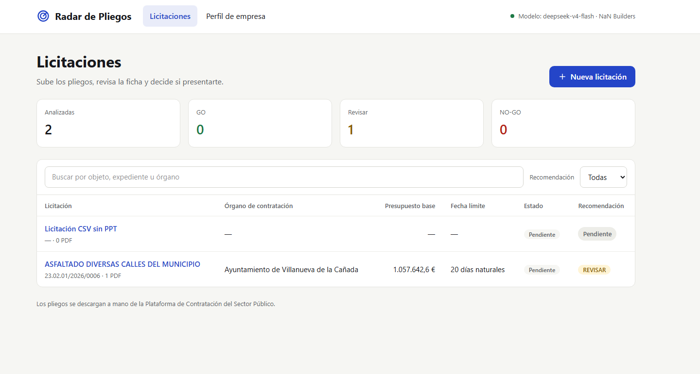
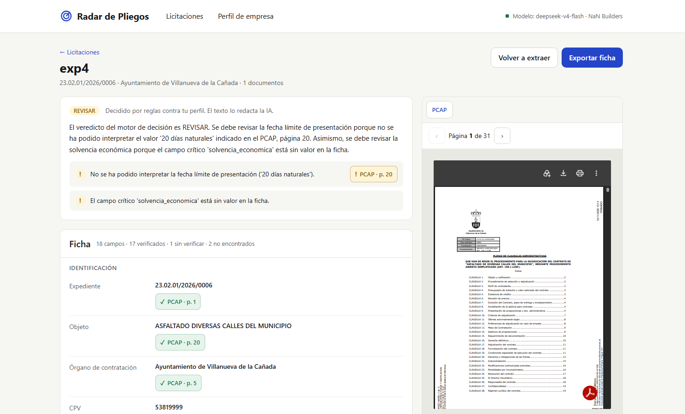
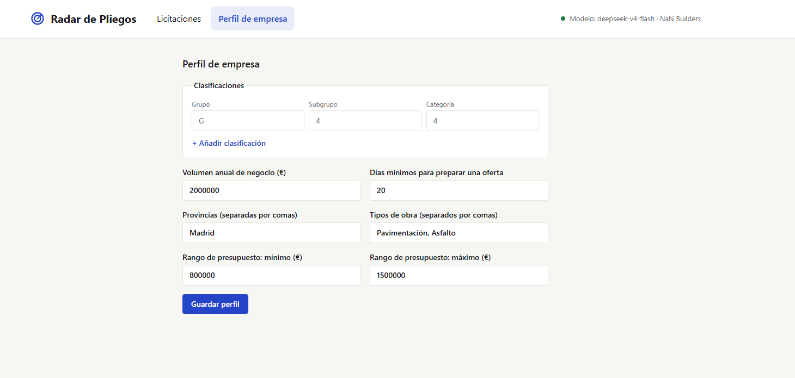
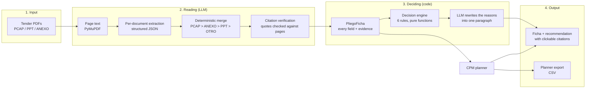
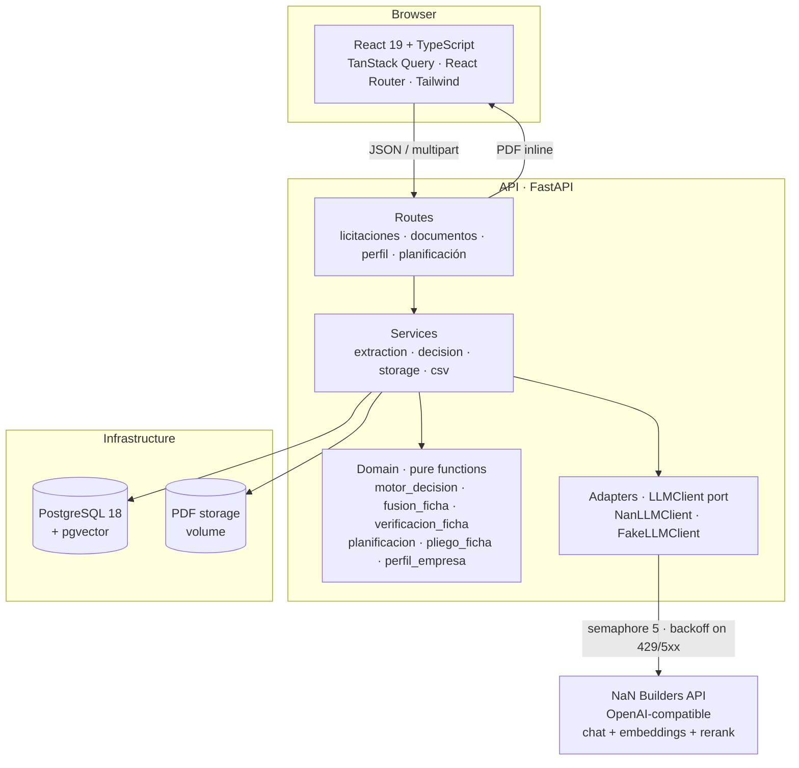
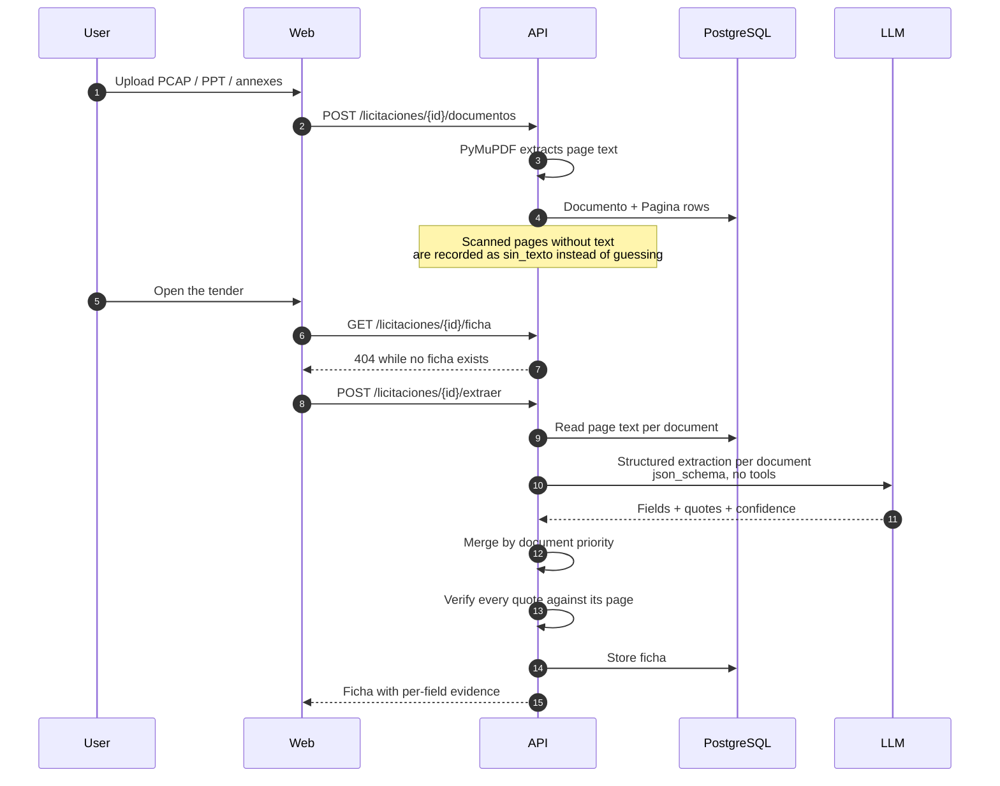
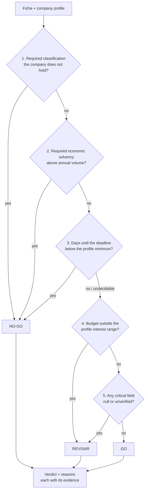
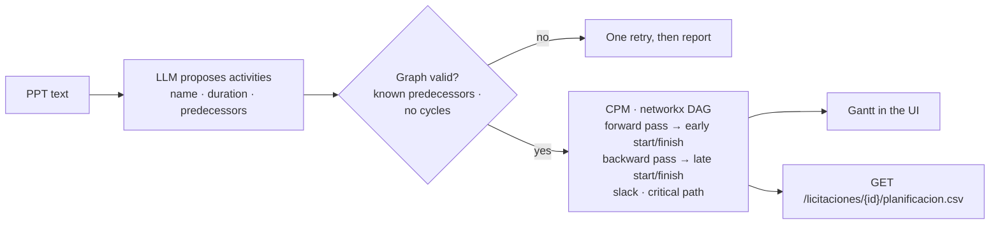
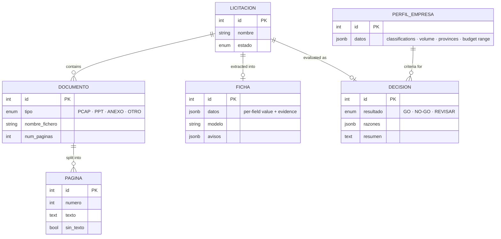
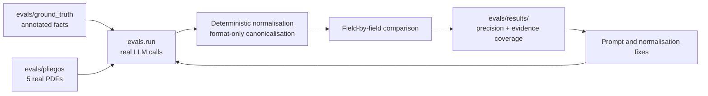

# Radar de Pliegos

Read a Spanish public works tender in **under two minutes** and decide whether to bid.

Radar de Pliegos receives the PDFs of a tender (the administrative terms — PCAP —, the technical
terms — PPT — and any annexes), extracts the facts that matter, and emits a
**GO / NO-GO / REVISAR** recommendation against a construction company profile. Every extracted
fact carries its evidence: document, page and the literal quote that supports it.

> **Design principle: the AI prepares, the person decides.**
> The LLM only reads and extracts. Every decision rule and every calculation lives in
> deterministic, unit-tested code. A language model never decides, never invents a number and
> never fills a gap: when it does not find something, the field stays empty and the ficha says so.

---

## What it looks like

| Tender list                                                                               | Tender detail                                                                                                |
| ----------------------------------------------------------------------------------------- | ------------------------------------------------------------------------------------------------------------ |
|  |  |

| Company profile                                                                                             |
| ----------------------------------------------------------------------------------------------------------- |
|  |

The detail view is the core of the product: on the left, the recommendation with its reasons and
the extracted ficha where **every value carries a chip** pointing at the document and page it came
from; on the right, the original PDF. Clicking a chip jumps the viewer to that page.

---

## The problem

A mid-sized construction company reviews dozens of tenders a month on the Spanish public
procurement platform. Each tender is 2 to 6 PDFs and 50 to 200 pages, and the critical facts are
scattered: the budget in one clause, the required classification in another, the penalties in an
annex. Reading and summarising one tender is 1 to 4 hours of a qualified technician.

The cost of getting it wrong cuts both ways:

- Bidding without the required classification means **automatic exclusion**.
- Skipping a good tender because nobody had time to read it is **money left on the table**.

Generic tools helped but did not solve it: pasting a PDF into a chat does not cite pages, invents
values when it finds nothing, and knows nothing about the company's own criteria.

---

## How it works



Three properties make the result trustworthy:

1. **Every non-null field has evidence.** A field with no quote is not a field.
2. **Quotes are verified, not trusted.** After extraction, each quote is searched in the page it
   claims to come from (normalised, fuzzy-matched). A quote that cannot be found is marked
   unverified and the UI paints that chip differently.
3. **The verdict is code.** The same ficha and the same profile always produce the same verdict.

---

## Architecture



**The dependency rule is the architecture.** `domain/` imports nothing from FastAPI, SQLAlchemy
or the AI SDK. That is what makes the rules testable in isolation and what keeps the LLM on the
edge, where it belongs.

| Layer           | Responsibility                                                                    | May import            |
| --------------- | --------------------------------------------------------------------------------- | --------------------- |
| `app/domain/`   | Pure business rules: decision engine, fusion, citation verification, CPM, schemas | stdlib, Pydantic only |
| `app/services/` | Orchestration: extraction, storage, decision, CSV                                 | domain, adapters, db  |
| `app/adapters/` | The only place that talks to the LLM provider                                     | domain ports          |
| `app/api/`      | HTTP surface and validation                                                       | services              |

---

## The extraction pipeline

Extraction is **per document, not per tender**: each PDF is read on its own and the results are
merged deterministically, so a conflicting or missing value from one document cannot silently
overwrite a better source.



**Field contract.** Every field is a `CampoExtraido[T]`:

```json
{
  "valor": "3",
  "evidencia": [
    {
      "documento": "PCAP",
      "pagina": 20,
      "cita": "El plazo de ejecución será de 3 meses"
    }
  ],
  "confianza": "alta",
  "verificado": true
}
```

`valor: null` means _not found_, which is information, not a failure. `verificado` means the quote
was actually located on that page.

---

## The decision engine

Six rules, evaluated in this order. Every applicable reason is collected and the verdict is the
most severe one, so **NO-GO always wins over REVISAR**.



The engine is a pure function: `evaluar(ficha, perfil, hoy=date)`. `hoy` is injected, so relative
deadlines ("20 días naturales") are reproducible in tests instead of depending on the clock.

**Rule 5 is the honest one.** If a critical field could not be extracted, or its quote could not be
verified, the engine answers REVISAR instead of guessing. A blank field never becomes a GO.

The LLM's last job is cosmetic: it rewrites the already-decided reasons into one readable
paragraph. If that call fails, the reasons are still there — the recommendation is never blocked
by a language model.

---

## The construction planner

The planner proposes the works schedule from the technical terms (PPT) and solves it with the
Critical Path Method.



Everything after the proposal is deterministic: the schedule, the slack and the critical path are
computed by code from durations and dependencies, never estimated by the model.

---

## Data model



`PAGINA` exists so that evidence can be verified: the citation check compares a quote against the
actual page text stored at upload time.

---

## Evaluation

Accuracy is measured, not assumed. `evals/` holds five real tenders with hand-annotated ground
truth and a runner that extracts, compares field by field and writes a report.



The loop works: the first honest run scored **51 %** field precision. Format-only normalisation,
a deterministic subcontracting fallback, canonicalised ground truth and one prompt rule took it to
**71 %**, with verified evidence above 97 %. The remaining gap is structural — the model sometimes
merges list items or picks the wrong object — and it is documented rather than papered over.

Evaluation calls the real API and costs quota, so it runs only on demand (`workflow_dispatch`),
never in CI. Tests use `FakeLLMClient` with deterministic fixtures; **no test ever calls the real
model**.

---

## API

| Method       | Path                                   | Purpose                                        |
| ------------ | -------------------------------------- | ---------------------------------------------- |
| `GET`        | `/health`                              | Liveness                                       |
| `GET` `POST` | `/licitaciones`                        | List and create tenders                        |
| `POST`       | `/licitaciones/{id}/documentos`        | Upload a PDF (multipart) and extract its pages |
| `GET`        | `/licitaciones/{id}/documentos`        | Documents of a tender                          |
| `GET`        | `/documentos/{id}/pdf`                 | Original PDF, served `inline` for the viewer   |
| `POST`       | `/licitaciones/{id}/extraer`           | Run the extraction and store the ficha         |
| `GET`        | `/licitaciones/{id}/ficha`             | Extracted ficha with evidence                  |
| `GET`        | `/licitaciones/{id}/decision`          | Verdict with its reasons                       |
| `GET` `PUT`  | `/perfil`                              | Company profile (single row)                   |
| `GET`        | `/licitaciones/{id}/planificacion`     | CPM plan                                       |
| `GET`        | `/licitaciones/{id}/planificacion.csv` | Same plan as CSV                               |

---

## Stack

| Area     | Choice                                                                                                    |
| -------- | --------------------------------------------------------------------------------------------------------- |
| Backend  | Python 3.14 · FastAPI · Pydantic v2 · SQLAlchemy 2 async · Alembic · PyMuPDF                              |
| Database | PostgreSQL 18 with `pgvector` (`pgvector/pgvector:pg18`)                                                  |
| Frontend | React 19 · TypeScript strict · Vite · pnpm · Tailwind CSS · TanStack Query · React Router                 |
| AI       | NaN Builders, OpenAI-compatible: `deepseek-v4-flash` for chat and extraction, `qwen3-embedding`, `rerank` |
| Quality  | `ruff`, `mypy --strict`, `pytest` · `eslint`, `prettier`, `tsc`, `vitest`, Playwright                     |
| Infra    | `docker compose` with `db`, `api` and `web`, all health-checked                                           |

**Why NaN Builders and an `LLMClient` port:** the provider is swappable and tests are free. The
adapter enforces a semaphore of 5 concurrent calls with exponential backoff and jitter on 429 and
5xx, so the app degrades predictably instead of hammering the API.

---

## Quickstart

```bash
git clone <repo> && cd Radar-de-Pliegos
cp .env.example .env          # fill in NAN_API_KEY
docker compose up -d          # db + api + web
```

- Web: <http://localhost:5173>
- API: <http://localhost:8000> (`GET /health` → 200, docs at `/docs`)

Then, in the UI: fill the company profile → create a tender → upload its PDFs → the ficha and the
recommendation appear on their own.

```bash
# Backend
cd backend && uv sync && uv run alembic upgrade head
uv run pytest
uv run ruff check . && uv run ruff format --check . && uv run mypy --strict app

# Frontend
cd frontend && pnpm install
pnpm vitest run && pnpm lint && pnpm typecheck && pnpm build
```

> **Note on the backend test suite:** the integration tests currently point at the `docker compose`
> database and reset the schema, so running `uv run pytest` wipes your local tenders. Isolating the
> tests in their own database is a known pending fix.

---

## Repository layout

```
.
├── AGENTS.md              Working agreement for agents: stack, TDD, RDD, git
├── BRIEF.md               Product specification (source of truth for scope)
├── docker-compose.yml     db + api + web
├── backend/
│   ├── app/domain/        Pure rules: decision engine, fusion, verification, CPM, schemas
│   ├── app/services/      Orchestration: extraction, storage, decision, CSV
│   ├── app/adapters/      LLMClient implementations (real and fake)
│   ├── app/api/           Routes
│   ├── migrations/        Alembic
│   └── tests/             unit + integration
├── frontend/
│   ├── src/features/      licitaciones (list, new, detail) and perfil
│   ├── src/lib/api.ts     Typed API client — views never call fetch directly
│   ├── public/img/        Screenshots used in this README
│   └── tests/e2e/         Playwright
├── evals/                 Real tenders, ground truth, runner and reports
└── odd/tasks/             Feature documents: specs, tasks, evidence, decisions
```

---

## How the work is done

The project runs on **ODD** (Organic Driven Development) with two non-negotiables:

- **TDD.** Every rule starts as a failing test. RED is observed before GREEN, and the evidence is
  recorded in the feature document. Deleting, skipping or weakening a test to get a green run is
  forbidden.
- **RDD.** Every work unit is reviewed before it is considered done: risk assessed per commit, and
  the full slice reviewed with the four lenses (risk, resilience, readability, reliability) when a
  feature closes.

Each task leaves a trail in `odd/tasks/<feature>.md`: the spec quoting the request verbatim, the
task list with stable IDs linked to specs, and a log of decisions, evidence and corrections. That
is what makes work resumable weeks later.

Git: `main` is stable and owned by the maintainer, `dev` integrates, work happens on
`feat/*` and `fix/*` cut from `dev`, one Conventional Commit per coherent unit with its tests and
docs. CI runs the backend gates, the frontend gates, the e2e suite and a `docker compose build`,
and the evaluation workflow is manual because it spends quota.

---

## Design decisions worth knowing

| Decision                                               | Why                                                                                                                       |
| ------------------------------------------------------ | ------------------------------------------------------------------------------------------------------------------------- |
| The LLM never computes anything                        | A verdict must be reproducible and auditable; models are non-deterministic and confidently wrong                          |
| One field = value + evidence + confidence + verified   | Correctness is per field, and a field without a quote is unverifiable                                                     |
| Extraction per document, merged by priority            | Stops a bad source from overwriting a good one and surfaces conflicts as warnings                                         |
| Merge and verification are deterministic               | Both are testable without a model and behave identically on every run                                                     |
| PDFs served `inline` with cache, viewer keyed per page | The browser plugin only honours `#page=` on load, so paging reloads the document — served from cache, never re-downloaded |
| `index.html` served `no-store`                         | A cached shell keeps pointing at the previous bundle and the app silently looks old                                       |
| Ambiguity yields REVISAR, never a guess                | A wrong GO on a tender you cannot legally bid costs a whole bid cycle                                                     |

---

## Limitations and roadmap

Honest about what is not finished:

- **Extraction accuracy is 71 %** on the annotated set. Remaining failures are structural: list
  items merged or split, and occasional wrong object extraction. Measured in `evals/results/`.
- **Relative deadlines are not resolved.** A pliego saying "20 días naturales" without a
  publication date cannot produce a real deadline, so the engine answers REVISAR. Correct, but it
  will fire on most tenders until the publication date is captured.
- **Backend tests share the compose database** and wipe local data. Isolating them is pending.
- **The PDF response lacks hardening headers** (`X-Content-Type-Options: nosniff`).
- **Single-user, single-company.** No authentication, no multi-tenant, no roles.
- **Works tenders only.** Services and supplies are out of scope for now.

Roadmap, in order of value: isolate the test database, resolve relative deadlines against the
publication date, raise list extraction precision, and add embeddings-based search over the corpus.

---

## Documentation

| Document          | Contains                                                              |
| ----------------- | --------------------------------------------------------------------- |
| `BRIEF.md`        | Product specification: problem, personas, phases, acceptance criteria |
| `AGENTS.md`       | Stack, conventions and the working agreement for agents               |
| `odd/tasks/*.md`  | One feature document per feature: specs, tasks, evidence, decisions   |
| `evals/README.md` | How evaluation works and how to run it                                |
| `INFORME.md`      | Project report: what was built, in what order, and what went wrong    |

---

Built by Albert as a deep dive into the problem Miranda AI solves, before talking to the people
building it. Architecture, rules and evaluation are meant to be read as much as the UI is meant to
be used.
