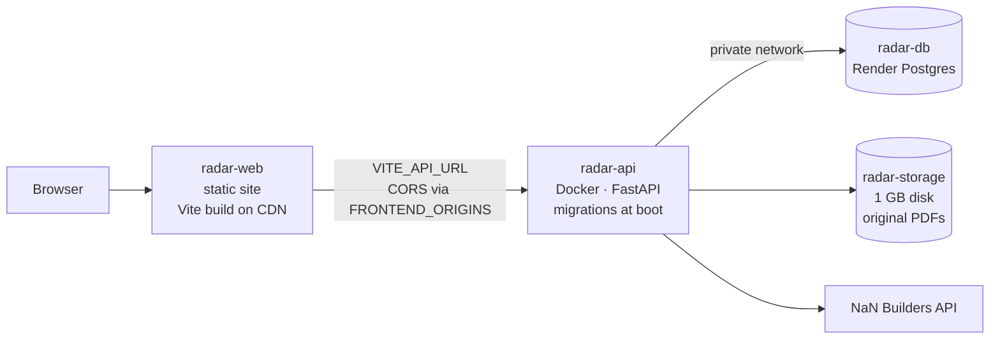

# Deploying to Render

This guide deploys Radar de Pliegos to [Render](https://render.com) using the
Blueprint in [`render.yaml`](../render.yaml). It creates three resources:



**Why these three and not one:** a static site cannot run Python, and the API
needs a process plus a persistent disk. Keeping the frontend static is cheaper,
serves from a global CDN and keeps the API free to scale on its own.

## What it costs

| Resource | Plan in `render.yaml` | Notes |
| --- | --- | --- |
| `radar-web` (static site) | Free | CDN, no process |
| `radar-db` (Postgres) | Free | **Deleted 30 days after creation.** Switch to `basic` to keep data |
| `radar-api` (Docker + disk) | Starter | A persistent disk requires a paid instance type |

If you only need a short-lived demo, the free database is fine. If the data must
survive, change `plan: free` to `plan: basic` under `databases:` before creating
the Blueprint — Render does not let you downgrade a database back to free later.

**Cheaper alternative without the disk:** remove the `disk:` block and set the
API plan to `free`. Uploaded PDFs then live on an ephemeral filesystem and are
lost on every deploy or restart, so every demo needs the PDFs uploaded again.
Everything else works the same.

## Prerequisites

1. The code is merged to `main` on GitHub (Render deploys that branch).
2. A Render account connected to that GitHub repository.
3. A NaN Builders API key (`NAN_API_KEY`) with quota left.
4. The repository root contains `render.yaml`, `backend/Dockerfile` and
   `frontend/Dockerfile`.

## Step 1 — Create the Blueprint

1. Open the Render Dashboard and choose **New → Blueprint**.
2. Select the `Radar-de-Pliegos` repository and the `main` branch.
3. Render reads `render.yaml` and shows the three resources. It also asks for the
   variables marked `sync: false`:
   - `NAN_API_KEY` — your real key.
   - `FRONTEND_ORIGINS` — leave it empty for now (step 3 fills it).
   - `VITE_API_URL` — leave it empty for now (step 3 fills it).
4. Confirm. Render creates the database first, then the API, then the static site.

The first API deploy fails or stays unhealthy if the key is missing: fill it in
step 3 too. That is expected on a first pass.

## Step 2 — Copy both public URLs

When the services finish creating, the dashboard lists them. Note:

- API URL, for example `https://radar-api.onrender.com`
- Web URL, for example `https://radar-web.onrender.com`

Open `https://<api-url>/health` first. It must return `{"status":"ok"}`. If it
does not, fix the API before going further (see Troubleshooting).

## Step 3 — Connect the frontend and the API

Two variables wire the pieces together, and **both are baked in at build time or
at boot**, so they need a redeploy afterwards.

1. **`radar-api` → Environment → `FRONTEND_ORIGINS`**: the web URL, exactly as it
   appears, with no trailing slash and no path:

   ```
   https://radar-web.onrender.com
   ```

   To allow several origins, separate them with commas:
   `https://radar-web.onrender.com,https://radar.example.com`

   Save. Render redeploys the API automatically.

2. **`radar-web` → Environment → `VITE_API_URL`**: the API URL, no trailing slash:

   ```
   https://radar-api.onrender.com
   ```

   Save. Then open **Manual Deploy → Clear build cache & deploy**, because Vite
   inlines `VITE_API_URL` into the bundle at build time; a cached build keeps the
   old value and the site shows network errors.

## Step 4 — Verify end to end

In order, on the deployed site:

1. `/health` on the API returns `{"status":"ok"}`.
2. The site loads with no red CORS errors in the browser console.
3. Fill the company profile and save it; the data survives a page reload.
4. Create a tender, upload a PDF, and let the ficha extract.
5. The PDF renders inside the viewer, and clicking an evidence chip jumps to its
   page. Paging does not re-download the file.
6. Reload a deep link such as `/licitaciones/1`: it must render, not 404 (the
   static site rewrite handles this).
7. Redeploy the API without touching the disk, then open an existing document:
   the PDF must still be there (this proves the disk is mounted).

## Environment variables

| Variable | Service | Value |
| --- | --- | --- |
| `DATABASE_URL` | API | Injected from the database by the Blueprint |
| `STORAGE_DIR` | API | `/app/storage` (the disk mount path) |
| `NAN_API_KEY` | API | Your NaN Builders key (secret) |
| `FRONTEND_ORIGINS` | API | Public origin(s) of the frontend, comma-separated |
| `VITE_API_URL` | Web | Public URL of the API, inlined at build time |

The API normalises the connection string: Render provides `postgresql://…`, and
the app rewrites it to `postgresql+asyncpg://…` and translates `sslmode=` to
`ssl=` for asyncpg. You do not need to edit `DATABASE_URL` by hand.

## How a deploy runs

- **API:** Render builds `backend/Dockerfile`, then runs
  `alembic upgrade head` and `uvicorn` on `$PORT` (Render injects it; locally it
  falls back to 8000).
- **Web:** Render runs `corepack enable && pnpm install --frozen-lockfile &&
  pnpm build` in `frontend/` and publishes `dist/`.
- The Blueprint tracks `main`: every merge to `main` redeploys production. Use
  **Settings → Build & Deploy → Auto-Deploy** to switch to manual.

## pgvector

The schema does not use Postgres vector types yet, so no extension is required
for the deploy. Render Postgres supports `pgvector` when embeddings land:

```sql
CREATE EXTENSION IF NOT EXISTS vector;
```

Run it from the database's **PSQL** tab in the dashboard. If you later need the
exact Postgres 18 image used locally, note that a managed instance follows
Render's supported versions instead.

## Troubleshooting

| Symptom | Cause and fix |
| --- | --- |
| API deploy fails, logs show `alembic` errors | Wrong `DATABASE_URL`, or the database is not ready. Check the database status, then redeploy the API |
| Browser console: CORS error / blocked request | `FRONTEND_ORIGINS` does not match the site origin exactly. No trailing slash, include `https://`, redeploy the API after changing it |
| Site loads but every request fails | `VITE_API_URL` was empty when the bundle was built. Set it and redeploy with **Clear build cache** |
| Upload returns 500, logs mention a path | The disk is not mounted or `STORAGE_DIR` differs from the mount path (`/app/storage`) |
| Documents vanish after a redeploy | The service has no disk (free plan) — attach one, or accept re-uploading |
| Deep link returns 404 | The static site is missing the `/*` → `/index.html` rewrite |
| PDF downloads instead of rendering | The API is serving `attachment`; this repository serves `inline` — check you deployed `main` |
| First request after a while is slow | Only applies to free instance types that spin down; the API here runs on Starter |

## Rolling back

Render keeps every deploy. Open the service → **Deploys** → pick the previous
one → **Redeploy**. The disk is not touched by a code rollback, so uploaded PDFs
stay. Rolling back the API does not roll back the database schema: if a migration
changed the schema, restore the database from a backup instead.
